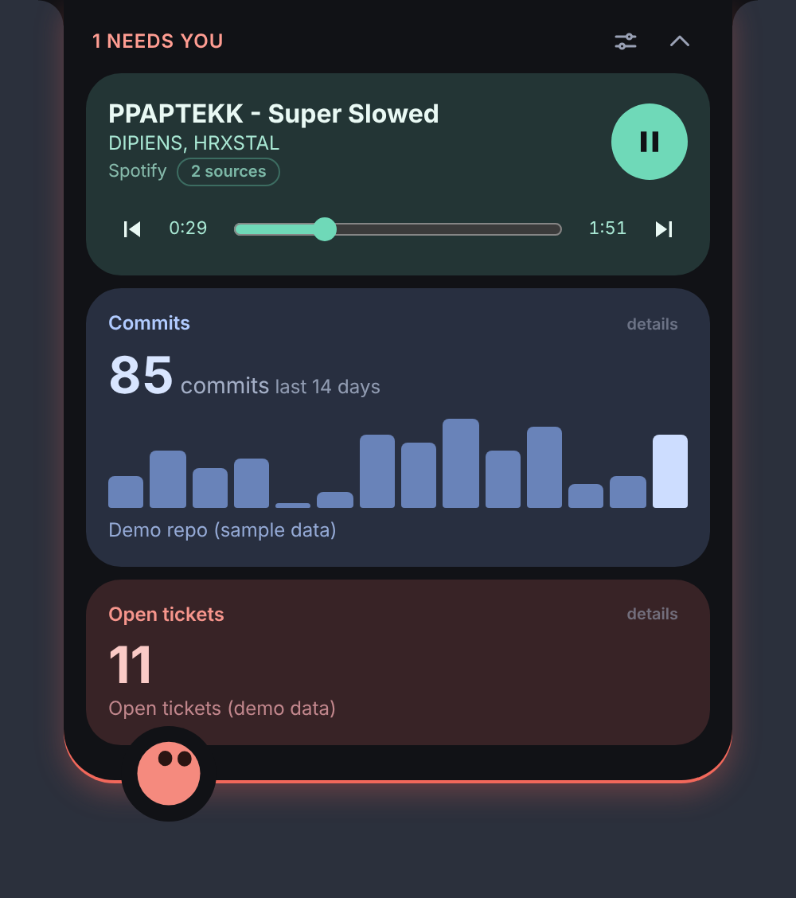
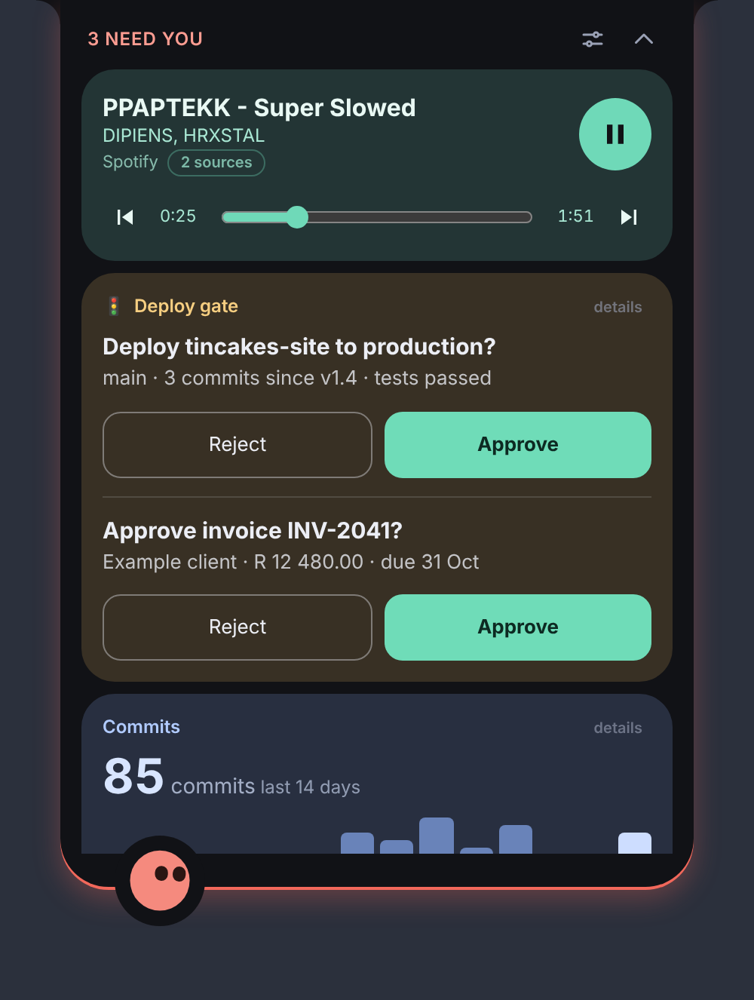
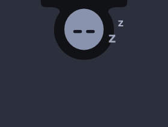
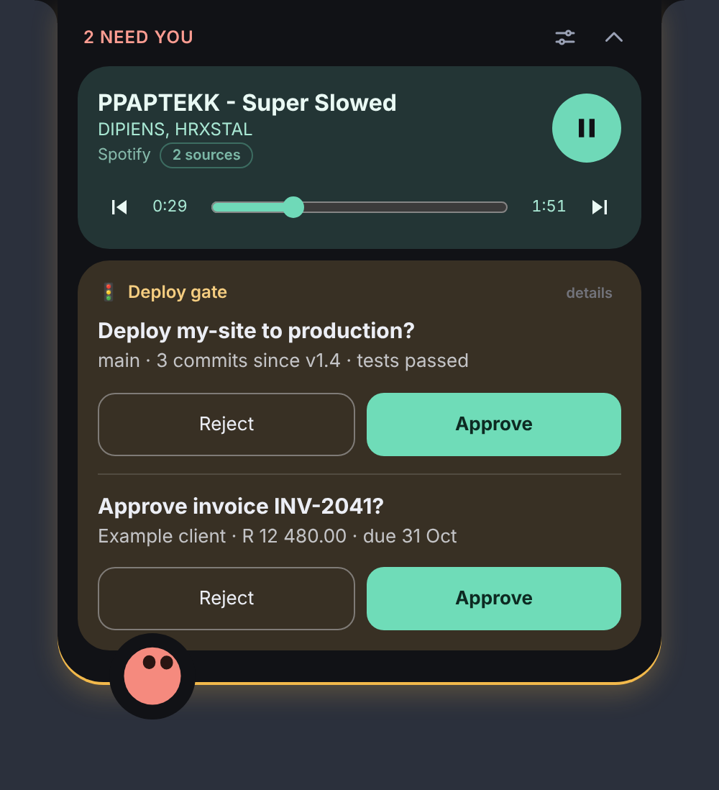

<div align="center">


# Perch

**A small companion that lives at the top of your screen.**<br>
Music, tickets, build status and "can I deploy?" questions, one glance away.

[](https://github.com/JustinDCS/perch/releases)


[](LICENSE)

<br>



</div>

---

Perch is an always-on-top island with a little avatar and a stack of **pills**: small cards that show what you want to see. It stays out of the way until something happens, then perks up, plays a chime and tells you.

## ✨ What it does

* 🎵 **Now playing.** Title, artist, artwork, previous / play-pause / next, progress and seeking. Spotify, Apple Music and (on Windows) anything with a media session.
* 🔌 **Anything with an API.** A pill polls a JSON address and shows a number, a status, a list or a bar chart: open Jira tickets, GitHub stars, commits per day. Colours change with thresholds, and rows link to the source.
* ✅ **Approval cards.** A pill can ask you a question with one to three buttons (Approve / Reject). A button only sends the request written in the pill file, and risky ones ask twice.
* 📥 **Local inbox.** Scripts and tools on your own PC can ask you a question through a loopback-only, key-protected endpoint. Off by default.
* 🐣 **An avatar with moods.** Awake, listening, alert, asleep. Use Perch's own or bring your own.
* 📚 **A Library.** Add a pill from a bundled example or a file in one click. Variables (your site, your email) are filled in from Settings, never edited in JSON.
* 🔄 **Updates itself.** Signed updates install in the background, and you can turn that off.

Pills and avatars are **small JSON files, not code**, so nothing you add can run anything on your PC.

## 👀 A look

<table>
  <tr>
    <td align="center" width="33%"><br><sub><b>Small</b><br>live chips while something plays</sub></td>
    <td align="center" width="33%"><br><sub><b>Resting</b><br>stays out, glances and winks</sub></td>
    <td align="center" width="33%"><br><sub><b>Asleep</b><br>after a quiet spell</sub></td>
  </tr>
  <tr>
    <td colspan="3" align="center"><br><br><sub><b>Needs you</b><br>approval cards turn the lip amber, play a chime and ask once</sub></td>
  </tr>
</table>

## 🔒 Safe by design

* Secrets live in the system credential store (Windows Credential Manager, macOS Keychain). The page can save one but nothing can read it back.
* Every address a pill talks to must be on a host **you approved**.
* Nothing answers a request for you, and an unanswered request never times out into a yes.

Details are in [Security model](#security-model).

## 📦 Get it

Download the installer from the [Releases page](https://github.com/JustinDCS/perch/releases): `.exe` / `.msi` for Windows, `.dmg` for Mac.

1. **Windows:** SmartScreen may warn about an unknown publisher (the build is not signed yet). Choose **More info → Run anyway**.
2. **Mac:** right-click Perch and choose **Open** the first time. See [macOS](#macos).
3. Perch appears at the top of the screen. The tray / menu bar icon has Show / hide, Library, Centre on this screen and Quit.

This is an early version. **Known issues:** seek dragging, the local inbox and approval cards against real services are still being proven on real PCs; on a Mac only Spotify and Apple Music are read; builds are unsigned.

**Feedback:** [open an issue](https://github.com/JustinDCS/perch/issues) with what you did, what you expected and what happened, and a screenshot if you can. Settings → Problems lists the last errors; copy them in.

## Build it yourself

Prerequisites: [Node 20+](https://nodejs.org), [Rust](https://rustup.rs), and on Windows the MSVC build tools (WebView2 is already on Windows 11).

```bash
npm install
npm run tauri dev      # the overlay, with hot reload
npm run tauri build    # installers in target/release/bundle/
npm run dev            # UI only, in any browser, with fake media and API data
```

```bash
npm test               # validators, paths, tones, every file in examples/
npm run test:core      # Rust safety rules
npm run typecheck
```


## macOS

Perch builds for macOS 12+ (Apple Silicon and Intel, one universal app). Prerequisites: Node 20+, Rust, Xcode command line tools (`xcode-select --install`). Then `npm install` and `npm run tauri dev` / `npm run tauri build` as above.

* **Installing a test build.** Builds are not signed with an Apple Developer ID or notarised, so Gatekeeper blocks the first launch. Drag Perch to Applications, then right-click it and choose **Open** (once). If macOS says it is damaged, run `xattr -cr /Applications/Perch.app`.
* **Media.** Spotify and Apple Music (Music.app) are supported. Perch only asks an app about its track if it is already running, and never launches it. The first time, macOS asks whether Perch may control Spotify / Music: choose **OK**. If you declined, re-enable it in System Settings → Privacy & Security → Automation. Other players (browsers, etc.) are not supported on macOS.
* **Placement.** The island hangs from the top edge of the screen, under the menu bar or notch. There is no Dock icon; use the menu bar icon for Show / hide, Library and Quit.
* **Secrets** go in the macOS Keychain. Allow access if it asks.

## Releasing and auto-update

Installed copies of Perch check for a newer version half a minute after start and every six hours, and install it by themselves (Library → Updates turns that off or checks by hand). Updates are signed, so Perch only accepts files made with the project's private key. They are fetched from this repository's latest published release, so the repository has to be public.

One-off setup:

1. Make a signing key on your own PC and keep the private file safe: `npx tauri signer generate -w ~/.tauri/perch.key` (set a password). Paste the **public** key into `src-tauri/tauri.updater.conf.json` in place of `REPLACE_WITH_PUBLIC_KEY`.
2. In this repo's Settings → Secrets and variables → Actions, add `TAURI_SIGNING_PRIVATE_KEY` (the key file's contents) and `TAURI_SIGNING_PRIVATE_KEY_PASSWORD`.

To release: bump the version (`package.json`, `src-tauri/tauri.conf.json`, both `Cargo.toml`), push a tag like `v0.1.3`, wait for the **release** run, then open the draft under Releases and **Publish** it. Publishing is what lets installed copies see it.

Without the key, the release run still builds plain installers into a draft pre-release. Developer and local builds have no updater; Library → Updates says so.

## Your config folder

Right-click the tray icon → **Open config folder** (it is `%APPDATA%\co.za.dyncomp.perch`):

```
pips\       one JSON file per pill
avatars\    one JSON file per avatar (or import one from Settings)
approved-hosts.json   hosts you have allowed (managed by Perch)
```

Copy anything from [`examples/`](examples) to get started. `examples/pips/tauri-stars.json` needs no secret.
Files with mistakes never crash Perch: they are listed with the exact problems under **Settings → Files with problems**.

## The island

Perch hangs from the top edge of your screen like a notch, with the avatar perched on its lower lip:

* **Resting**: when nothing is happening Perch stays out on a small ledge at the top edge, looking around and winking now and then. After ten quiet minutes he falls asleep (grey, eyes closed, a few z). Music or a pill that needs you widens the ledge into the small view. In Library → Behaviour, switch off *Stay visible when nothing is happening* to get the old thin sliver instead.
* **Seasonal looks**: around New Year (31 Dec – 2 Jan), Halloween (24 Oct – 1 Nov), Valentine's (12 – 14 Feb) and Christmas (15 – 26 Dec) Perch wears a hat or a little decoration while resting, and now and then (about one peek in three) does a short seasonal move instead of the wink: a party popper, peek-a-boo, a flower and a kiss, or a cookie with milk. Library → Behaviour has Auto/Off and a one-minute preview for each. Reduced motion is respected.
* **Small**: while music plays or a pill needs attention it shows one chip per pill (♪ track, ★ value, count). In the Library, each pill has *Show in the small view*: switch it off for a pill you only want when the island is open (for example tickets, if you only care about the song). A switched-off pill still shows its chip when it turns amber or red.
* **Home**: rest the pointer on it for about a second (a ring fills beside the pointer; Library → Behaviour changes the wait) or click the avatar to keep it open. Brushing past it does nothing, so it will not cover things at the top of your screen. A pill that turns red opens it by itself, and it stays open until you have been over it and left.
* **Moving it**: drag the avatar. The island slides along the top edge of whichever screen the pointer is on, and remembers where you dropped it. Library → Behaviour → *Centre on this screen* resets it.
* A line along the lip takes the worst tone: green, amber or coral.

Each pill file may set an `"accent": "#rrggbb"` colour for its chip and card.

## Life

The scripted poses sit under a small "alive" layer (`src/avatar/life.ts`): the eyes follow the pointer anywhere on screen while the island is open (Library → Behaviour: always or never) and wander when nobody is there, the body breathes, blinks are irregular (the odd double or slow one), and each loop runs on a slightly varying clock so it never repeats in lockstep. It ignores the pointer while asleep and is switched off by the system's reduced-motion setting.

**Dancing.** While music plays it bounces and sways with a tempo that drifts, and every 7 to 16 seconds it moves to a different dance (the built-in avatar has bounce, sway, cheer and laugh; an imported avatar uses whichever of `happy`, `excited`, `playful`, `celebrate` and `laughing` it defines).

**Reactions.** It responds to things: it hops when music starts or the track changes (and glances at the card), is startled when you grab it and squashes when you drop it, and leans back with wide eyes just before an alert opens. While the island is hidden it occasionally slides out, looks left and right, winks and slides back (Library → Behaviour switches this off).

## More than one app playing

Perch lists every app that reports media to Windows. When there is more than one, the now-playing card shows a small badge next to the app name ("+1 playing" while another app is playing, otherwise "2 sources") and the small chip gets a "+1". Click the badge to switch to the next app; the controls, progress and artwork then follow that app. Your pick lasts until that app closes, or until it was playing, paused, and something else is playing. When a second app starts, the avatar looks from side to side.

## Sounds

Small synthesised blips (no audio files): a two-chirp "hey" when a pill turns red, a tick when the island opens, a pop on a new track, a little arpeggio when music starts, a squeak and a thud when you grab and drop it, and tiny sounds for the peek, the wink, falling asleep and waking. Library → Sounds sets *All sounds*, *Alerts only* or *Off* and the volume (default 35%). Each sound has a cooldown so nothing repeats rapidly. The window is allowed to play audio without a click first (`additionalBrowserArgs` in `tauri.conf.json`).

## Library

Open the Library with the sliders icon (or the tray menu). **Pills** has a switch per pill (and for whether it shows in the small view), the blanks a pill asks for, **+ Add from file** (a pill `.json` is checked, then copied into your config folder) and **Browse examples** (the Jira, GitHub and approval examples that ship inside Perch, one click each). **Avatar**, **Secrets and access**, **Behaviour** and **Sounds** follow.

## Local inbox

Off by default. Turn it on in **Library → Local inbox** and any program on this PC can ask you a question and wait for your answer, for example a build script ("Run npm publish?") or a tool that wants permission. Perch listens only on `127.0.0.1` (port 47600 or the next free one), never on the network.

```
curl.exe -X POST http://127.0.0.1:47600/ask -H "X-Perch-Key: <your key>" -d "{\"title\":\"Run it?\",\"detail\":\"my-site 1.5.0\",\"buttons\":[\"Allow\",\"Deny\"]}"
```

The call waits and then returns `{"answer":"Allow"}`; `{"answer":null,"reason":"dismissed"}` if you dismissed it, or HTTP 408 with `"reason":"timeout"` if nobody answered. Fields: `title` (1 to 120 characters), `detail` (optional, up to 240), `buttons` (1 to 3 labels, the first is highlighted), `source` (optional label such as "build script"), `timeoutSeconds` (optional, 5 to 3600, default 300). The question shows as a card at the top of the island, counts in "N need you", and opens the island for a few seconds like any new request. If the program hangs up, the card disappears.

Rules: the key (Library → Local inbox) must be sent as `X-Perch-Key`; requests with an `Origin` header (web pages) or a `Host` other than this PC are refused; at most 8 questions at once; nothing is ever answered for you. The rules and the server are in `crates/perch-core/src/inbox.rs`, tested over real sockets.

## Pill manifest

```json
{
  "perch": 1,
  "id": "jira-open-tickets",
  "name": "Open tickets",
  "kind": "rest",
  "icon": "🎫",
  "refreshSeconds": 120,
  "request": {
    "url": "https://your-site.atlassian.net/rest/api/3/search/approximate-count",
    "method": "POST",
    "auth": { "type": "basic", "user": "you@example.com", "secret": "jira-token" },
    "body": { "jql": "project = DD AND statusCategory != Done" }
  },
  "display": {
    "layout": "stat",
    "value": "count",
    "label": "Not done",
    "thresholds": [
      { "gte": 25, "tone": "danger" },
      { "gte": 10, "tone": "warn" },
      { "lte": 9, "tone": "good" }
    ]
  }
}
```

* `kind`: `"rest"` or `"now-playing"` (the built-in now-playing pill is always available; it needs no file).
* `request.auth`: `bearer`, `header` (with a header `name`) or `basic` (with a `user`). The `secret` is only
  the **name** of an entry in the system credential store (Windows Credential Manager, macOS Keychain). Set its value in **Settings → Secrets**. Never put a token in a manifest.
* `request.method`: `GET` (default) or `POST` (`body` is only allowed with `POST`). `refreshSeconds`: 5 to 86400, default 60.
* `display.layout: "stat"`: `value` (path), optional `label`, `unit`, and `thresholds`. The first matching rule wins; each rule has
  `gte` / `lte` / `equals` and a `tone` of `neutral`, `good`, `warn` or `danger`.
* `display.layout: "list"`: `items` (path to an array), `title` and optional `subtitle`, `limit` (1 to 20). `title` and `subtitle` are either a path inside each item (`fields.summary`) or a template with holes (`{key} {fields.summary}`). An optional `link` is a web address template (`https://your-site.atlassian.net/browse/{key}`, or `{html_url}` to use a link from the response); clicking the row opens it in your browser, but only if its host is one you have approved.
* `variables` (optional, up to 8): blanks the user fills in under **Library → Pills**, used as `{var.name}` in `request.url`, the `basic` auth `user`, string values in `body`, and `display.link`. Each has a `key` (lower case), a `label`, and optionally `placeholder`, `default`, `type` and `group`. `type: "host"` accepts a pasted web address and keeps just the host name. Pills with the same `group` share one value, so two Jira pills ask for the site once. Until every blank without a default is filled, the pill shows "Needs setup". In a URL, a variable in the host part must look like a host name (so it cannot redirect the request), and anywhere else it is URL-encoded for you. The scheme (`https://`) must be typed in the manifest. Values are stored on the user's machine and are not secrets: tokens still go in **Secrets**.
* `display.layout: "chart"`: one bar per number. `values` is a path (or up to four, joined in order) to an array of numbers; `unit`, `period` (a small caption such as "last 2 weeks") and `label` are optional. It shows the total and highlights the last bar. If the arrays hold objects, `field` names the number inside each. A path index can be negative (`[-1]` is the last item). Examples: `examples/pips/github-activity-account.json` (your whole account, from GitHub's GraphQL API; needs a token), `examples/pips/github-activity.json` (commits per day for any public repo, from GitHub's statistics endpoint; GitHub may answer empty for a minute the first time, and the pill says so).
* `display.layout: "approvals"`: questions waiting for you, each with one to three buttons. `items`, `title` and optional `detail` work as in a list. Each of `actions` has a `label`, a `tone` (`neutral`, `good` or `danger`), a `post` address and optionally a JSON `body` and a `confirm` (`true`, or the question to ask, which may use `{holes}`). Pressing a button sends one POST to `post` with the pill's own `auth`; `{holes}` in it come from the item and are URL-encoded, and the host part must be literal text or `{var.name}`, never taken from the response, and must be a host you have approved. While anything is waiting the island counts it ("2 need you"), turns amber, and a *new* request makes the avatar perk up, plays the alert chime and opens the island for 8 seconds. Nothing is ever answered for you, and a request with no answer stays on its card. A reply with an empty body counts as success. Example: `examples/pips/approvals-example.json`.
* Paths use names, dots and `[0]` indexes, e.g. `fields.summary` or `issues[0].key`. `.length` works on arrays.

A pill whose tone is `danger` makes the avatar switch to its **attention** state.

### Example: Jira Cloud

Two examples are in `examples/pips/`: `jira-open-tickets.json` (a count that turns amber and red) and `jira-assigned-to-me.json` (your five most recently updated tickets, each one opening in Jira).

1. Create an API token at <https://id.atlassian.com/manage-profile/security/api-tokens>.
2. In Perch: Library → Secrets, add a secret named `jira-token` and paste the token. It goes to the system credential store and is never shown again.
3. Copy the examples into your config folder (Library → Open config folder → `pips`) and press Reload.
4. In Library → Pills, fill in your **Jira site**, **Atlassian email** and, if you like, the project key or the JQL. The two pills share the site and email. No file editing needed.
5. The pill asks to contact your site: choose Allow. The row links use the same host, so they work after that.

If a REST pill shows a value you did not expect, open the island and press **details** on that pill: it shows the address it asked (without the query string), the time, and the start of the response or the error, so you can see what the API really returned.

## Avatar format

An avatar is a body shape, eyes and a mouth, plus how they look in each state. See
[`examples/avatars/blob.json`](examples/avatars/blob.json). `idle` is required; `attention` and `music` default to `idle`.

* `body.shape`: `squircle`, `circle` or `pill`. Colours are `#rrggbb` only.
* Per state: `eyeOpen` (0 to 1.4), `eyeOffsetX/Y`, `mouth` (-1 frown to 1 smile), optional `bodyColor`,
  `animation` (`none`, `breathe`, `bounce`, `wiggle`, `pulse`) and `speed`.

### Avatars from Bible Strong Avatar Lab

Perch also reads the `.avatar.json` files exported by [Bible Strong Avatar Lab](https://github.com/smontlouis/bible-strong-avatar-lab)
(schema `bible-strong/avatar-definition`, version 1). Make an avatar in their Studio, open its **Export** tab, and import
the `.avatar.json` from **Settings → Avatar → Import avatar JSON**. Perch plays one of the avatar's own animations for
each state:

| Perch state | Animations tried, in order |
|---|---|
| idle | `idle`, `listening`, `bored` |
| music | `happy`, `excited`, `playful`, `celebrate`, `laughing` |
| attention | `surprised`, `scared`, `curious`, `angry` |
| asleep (after 10 quiet minutes) | `sleeping`, `drowsy`, `bored` |

If none exist, the avatar's first animation is used. Perch's own default avatar is written in this same format, so it can be used as a starting point. Perch draws a flat 2D version of the face (the Studio draws a lit 3D
shape), so it will look close to, not identical to, the Studio preview. Reduced-motion settings in Windows show a still face.

This is a **file format reader only**. The checks (`src/avatar/bibleStrong/schema.ts`) and the player are Perch's own
code; no code from the Studio or its `@bible-strong/*` packages is used, which is what keeps Perch's licence a free choice.

## Security model

User files are data, never code. Several layers keep it that way:

* **Strict validation.** Every pill and avatar file is checked against a schema. Unknown fields, bad ranges and
  non-`#rrggbb` colours are rejected with a clear message.
* **No markup from files.** The avatar is built with DOM calls and API text is set with `textContent`. Nothing user- or
  server-supplied is ever turned into HTML or SVG markup.
* **Requests are made in Rust**, not in the web view, so API keys never enter the page. Responses are capped at 1 MB with a 10 s timeout, and redirects are not followed.
* **Secrets** live in the system credential store (Windows Credential Manager, macOS Keychain). The page can save and delete one, but no command reads one back.
* **Host approval.** A pill cannot contact a host until you approve it in a prompt; you can revoke it in Settings.
  Plain `http` is only allowed for `localhost` and private-network addresses, and link-local addresses (including cloud metadata
  endpoints) are always refused.
* **Files** are only read from and saved to the two config folders, with sanitised names and a 256 KB limit.

This is a defence against a careless or malicious *file*. It is not a sandbox against malicious *code*: anything that can
already run code as you does not need Perch.

## Layout

```
src/                 TypeScript UI (no framework)
  pills/             manifest validation, now-playing and REST pills
  avatar/            schema, built-in avatar, SVG renderer
  ui/                app shell, settings, dialogs
  ipc.ts             the only bridge to Rust (plus a browser mock for development)
src-tauri/           Tauri shell: media (Windows), net, secrets, files
crates/perch-core/   platform-independent safety rules, unit-tested anywhere
examples/            sample pills and avatars (all validated by the test suite)
```

## Not yet

* Obsidian pill (note create via `obsidian://` / vault files, note search)
* Shuffle, repeat, volume and "add to library" controls
* Avatar configurator, extra avatar parts
* Signed and notarised installers

## Licence

[MIT](LICENSE). Perch contains **no code from** `bible-strong-avatar-lab` (AGPL-3.0): the avatar format and renderer here are original.
